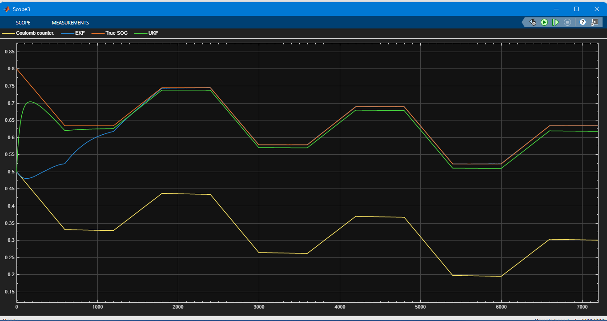
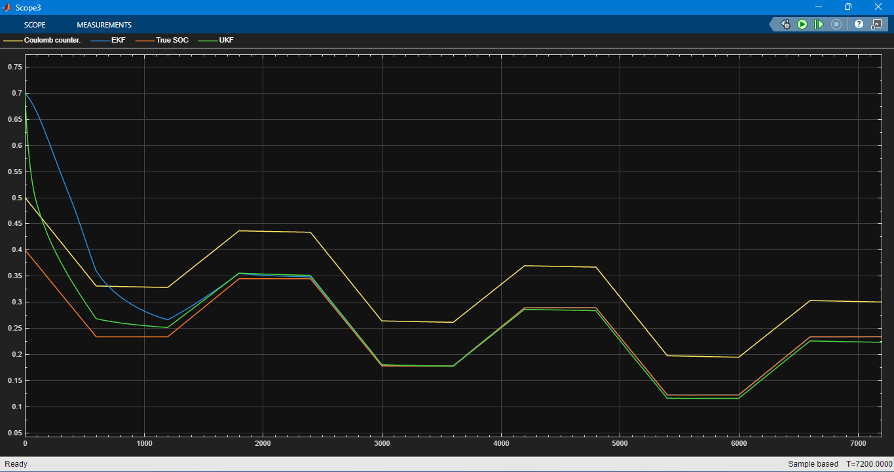
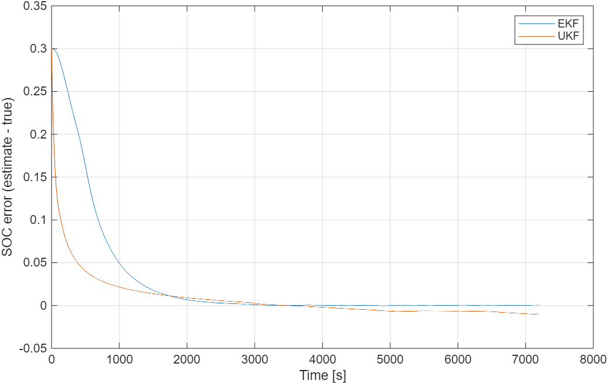

# UKF vs EKF for Battery SOC Estimation (Simulink / Simscape Battery)

  

**Same cell, same noisy sensors, same wrong starting guess: an Extended Kalman Filter (EKF) and an Unscented Kalman Filter (UKF) estimate the state of charge side by side. The UKF converges much faster; the EKF settles more accurately.**

Part of my 30-day self-study series on battery management systems (BMS). Author: Ali Sher, M.Sc. Hybrid Electric Propulsion Technology, BTU Cottbus-Senftenberg.

---

## TL;DR
| | EKF | UKF |
|---|---|---|
| Speed of convergence after a bad start (scenario 2) | within 0.05 SOC after about 1000 s | within 0.05 SOC after about 400 s |
| Typical error after 1800 s (RMS) | **0.0023** | 0.0061 |
| Worst error after 1800 s | 0.0101 | 0.0107 |
| How it copes with the nonlinear OCV curve | linearizes (uses the slope) | no linearization (sigma points) |

The largest gap between the two estimates is **0.18 SOC**, in the first minutes, where the UKF has already corrected most of the wrong start while the EKF is still far away. After settling, both stay within about 1 % SOC. The convergence times are read from the plots, so they are approximate.

---

## Setup
The true cell is a Battery (Table-Based) block with a one-RC-pair model (3 Ah, R0 = 20 mOhm, R1 = 15 mOhm, tau1 = 30 s, OCV from 3.0 V to 4.2 V). Both filters, and a Coulomb counter for reference, see only **measured** signals:
- **Current:** true current plus a **+0.05 A offset**
- **Voltage:** true voltage plus about **5 mV Gaussian noise**
- **Temperature:** constant 25 degC (298.15 K)

Load: +3 A for 600 s, rest 600 s, -2 A for 600 s, rest 600 s, repeated for 7200 s.

Both estimators are the SOC Estimator (Kalman Filter) block from Simscape Battery, with identical settings except the filter type:

| Setting | Value |
|---|---|
| Sample time | 1 s |
| Process noise Q | diag(1e-6, 1e-6) |
| Measurement noise R | 2.5e-5 |
| Initial covariance P0 | diag(0.1, 1e-4) |

## Scenario 1: true SOC 0.80, filters start at 0.50
The UKF (green) climbs to the true value within roughly 600 s and then runs about 0.01 to 0.015 below it. The EKF (blue) needs about 1800 s to reach the true value and then follows it closely. The Coulomb counter (yellow) stays about 0.3 too low for the whole run.



## Scenario 2: true SOC 0.40, filters start at 0.70
The true SOC falls to about 0.12 during the run, so it crosses the steep part of the OCV curve (below 0.2), where the voltage-SOC relation bends the most. The UKF is within 0.05 of the truth after about 400 s, the EKF after about 1000 s. Afterwards the EKF error sits near zero, while the UKF runs slightly low.



Error (estimate minus true) for both filters:



Note: in this scenario the Coulomb counter started at 0.50 instead of 0.70, so its curve is not directly comparable to the filters' start.

---

## What this shows
1. **UKF: faster start.** With a large initial uncertainty, the UKF's sigma points spread over the bend of the OCV curve and give a stronger early correction.
2. **EKF: tighter steady state** on this cell: RMS 0.23 % against 0.61 % SOC after 1800 s. The difference is small in practice (0.4 % of 3 Ah is about 12 mAh).
3. **No filter wins everywhere.** The EKF is cheaper to compute and is the common choice in BMS software. A UKF is worth considering when a fast start matters or the nonlinearity is strong.
4. **My first prediction was wrong.** I expected both filters to look almost identical on the gentle part of the OCV curve. They did not, so I tested it and report what happened.
5. **Both filters beat Coulomb counting** with a wrong start and a biased current sensor, which never recovers.

## How the error was measured
```matlab
t = out.tout;  soc_true = out.true.Data;  soc_ekf = out.ekf.Data;  soc_ukf = out.ukf.Data;
k = t > 1800;                       % ignore the start-up phase
e_ekf = soc_ekf - soc_true;  e_ukf = soc_ukf - soc_true;
fprintf('EKF: RMS %.4f   max %.4f\n', sqrt(mean(e_ekf(k).^2)), max(abs(e_ekf(k))));
fprintf('UKF: RMS %.4f   max %.4f\n', sqrt(mean(e_ukf(k).^2)), max(abs(e_ukf(k))));
fprintf('Largest EKF-UKF difference: %.4f\n', max(abs(soc_ekf - soc_ukf)));
```
Signals are logged with To Workspace blocks (true, ekf, ukf).

## How to run
1. Open `day14_ukf_vs_ekf.slx` in MATLAB (Simulink, Simscape, Simscape Electrical, Simscape Battery, R2022b or later).
2. Set the stop time to 7200 s and run.
3. Scenario 1: battery initial SOC 0.8, InitialSOC constant 0.5. Scenario 2: battery initial SOC 0.4, InitialSOC constant 0.7.

## Limitations (honest version)
- The true cell has the same one-RC structure as the filters' internal model, which favors both filters.
- Synthetic load, Gaussian noise and constant temperature, no measured data, no aging.
- Results come from one tuning (Q, R, P0) and one noise sample. I did not test whether other tunings change the ranking.
- The UKF's small late bias is observed, but I have not isolated its cause (candidates: the 0.05 A current offset, and the large initial covariance).

## Roadmap
- [ ] Test the two hypotheses for the UKF bias: no current offset, smaller P0
- [ ] Capacity error and aging
- [ ] Standard drive cycle and, later, measured data
- [ ] Write the EKF myself in a MATLAB Function block

---

## More from this series
| Project | Topic |
|---|---|
| [kalman-filter-soc-estimation](https://github.com/alisherbtu/kalman-filter-soc-estimation) | EKF vs Coulomb counting |
| [coulomb-counting-soc-estimation](https://github.com/alisherbtu/coulomb-counting-soc-estimation) | how three faults make Coulomb counting drift |
| [active-cell-balancing](https://github.com/alisherbtu/active-cell-balancing) | charge-transfer balancing |
| [passive-cell-balancing](https://github.com/alisherbtu/passive-cell-balancing) | bleed-resistor balancing |
| [battery-pack-grid](https://github.com/alisherbtu/battery-pack-grid) | grid-connected pack model |

*Learning project: all results come from the simulation model described above, not from lab measurements.*
